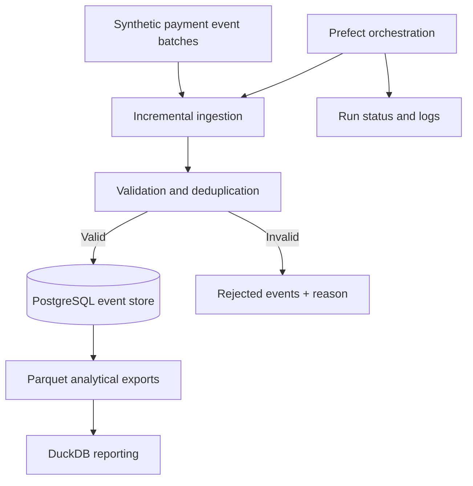

# Incremental Payment Analytics Pipeline

**Python · PostgreSQL · Parquet · DuckDB · Prefect**

> **Development status:** Proposed architecture and roadmap are published. Ingestion code, orchestration, tests, and metrics will be added as they are implemented. This README does not claim a working pipeline yet.

## Overview

A **batch-based incremental** data pipeline for processing synthetic payment events safely across repeated runs. The design focuses on correctness under duplicates, retries, late-arriving events, and interruptions.

This is not a Kafka or real-time streaming project.

## Proposed architecture



## Planned engineering features

- Generate synthetic payment event batches with unique event IDs.
- Track processed inputs through a checkpoint or durable watermark.
- Deduplicate and upsert so retries do not inflate downstream counts.
- Quarantine invalid events; record validation reasons.
- Generate Parquet exports and analyze them with DuckDB.
- Use Prefect for local orchestration, retries, and run observability.
- Test repeated runs, duplicate input, and interrupted processing.

## Correctness criteria (to be tested)

1. Replaying the same event batch does not duplicate business events.
2. An interrupted run can restart without silent data loss.
3. Invalid records are recorded and counted.
4. Reconciled accepted/invalid input counts are explainable.

## Planned repository structure

```text
src/
  generate_events.py
  ingest.py
  checkpoints.py
  validate.py
  export_parquet.py
  reports.py
flows/
  payment_pipeline.py
sql/
  schema.sql
tests/
requirements.txt
README.md
```

*Structure shown is a target, not evidence that these files exist yet.*

## Delivery roadmap

- [ ] Event format, synthetic data, and relational schema
- [ ] Basic incremental processing and event deduplication
- [ ] Durable checkpoint handling and retry tests
- [ ] Parquet export and DuckDB reports
- [ ] Prefect orchestration and execution logs
- [ ] Documentation for running and verifying the pipeline

## Run locally

A reproducible runbook will be added together with tested application code. No throughput, latency, or fault-tolerance metrics are claimed before measurement.

---
**Maintainer:** [Mayank Acharya](https://github.com/blizzardshark)
